# vme-insight

Performance history, capacity, inventory and lifecycle dashboards for **HPE Morpheus VM Essentials (VME)**, in one `docker compose` stack.

VME's own UI shows current values but little history, and nothing about whether guest operating systems are near end of life. vme-insight polls the VME API every minute and keeps the data in TimescaleDB. Grafana shows it in dashboards modelled on the popular [VMware vSphere Overview](https://grafana.com/grafana/dashboards/8159-vmware-vsphere-overview/) dashboard. An optional exporter layer adds kernel-level host and per-VM metrics (CPU ready/vCPU wait, pressure stall, disk latency, NIC drops) that the API does not expose.

**Supported:** VME 9.1 and later (tested on 9.1.0.1 with HVM 2.0 clusters on Ubuntu 26.04 hosts).

> **Community project.** vme-insight is independent and community maintained. It is not affiliated with, endorsed, sponsored or supported by Hewlett Packard Enterprise, Morpheus Data, or any related organisation. See the [disclaimer](#disclaimer).

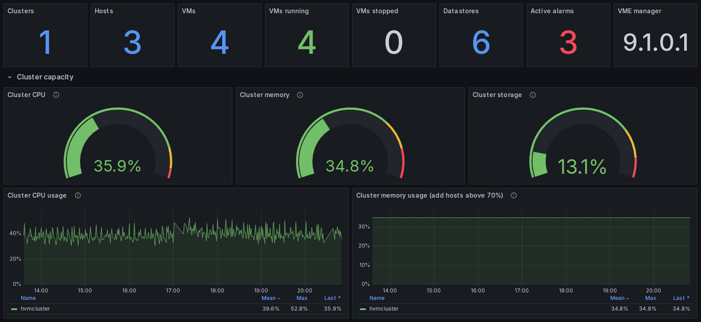

## What you get

| Dashboard | Source | Shows |
|---|---|---|
| **VME Overview** | API → TimescaleDB | Estate counts, cluster CPU/memory/storage gauges and trends, host CPU/memory, datastores, manager health and services, clouds, recent activity, top VMs by CPU/memory/CPU ready/network, power state and OS mix |
| **VME Hosts** | API → TimescaleDB | Host inventory (hardware, CPU model, cluster membership, maintenance), CPU, CPU ready, memory, swap, storage, network, running VMs, vCPU:core ratio |
| **VME Virtual Machines** | API → TimescaleDB | Per-VM CPU, CPU ready, memory, disk, IOPS, network, power history, full VM inventory |
| **VME Inventory & Lifecycle** | API + endoflife.date | OS end-of-life and update status, Morpheus agent and QEMU guest agent status, OS releases in use, unrecognised OS strings, a change log of every inventory change |
| **VME Manager & Collector** | API → TimescaleDB | Alarms, manager CPU/JVM/system memory, filesystems, database connections, RabbitMQ backlog, Elasticsearch, collector run history and errors, database size |
| **VME HVM Hosts & VMs** *(exporters)* | Prometheus | Host table, disk IOPS and latency, physical NIC traffic, per-VM table with vCPU wait, RSS, IOPS and traffic, top-10 charts |
| **VME HVM Bottlenecks** *(exporters)* | Prometheus | CPU/memory/I/O pressure (PSI), load per core, vCPU wait, swap and page faults, disk busy and latency, noisy neighbours, interface drops and errors |
| **VME Data Export** | API → TimescaleDB | Pick kind, entities, metrics, time range and resolution, then download CSV: metric samples, hourly rollups, full inventory with lifecycle status, changes, alarms, activity, and any object's raw API record |
| **VME HVM Capacity** *(exporters)* | Prometheus | vCPU:core ratio, memory allocated vs installed, idle cores, 30-day trends |
| **VME Summary tiles** | API → TimescaleDB | Estate and CPU contention tiles with fixed ids, for embedding in other pages (used by the VME plugin) |

Every dashboard works without the exporters except the three marked *(exporters)*. For big exports there's also a command-line tool; see [EXPORTS](docs/EXPORTS.md).

**Inside VME too (optional).** The companion [vme-insight-plugin](https://github.com/grahamfairbank/vme-insight-plugin) adds a **vme-insight** tab to VME's host, VM, instance and cluster pages, showing these dashboards in place. vme-insight doesn't need it. Setup: [VME-PLUGIN](docs/VME-PLUGIN.md).

## A tour

Screenshots are from a three-host VME 9.1 lab running real workloads. Server names and IP addresses are blurred; nothing else is edited. The same tool that took them is in the repo ([`tools/screenshots.py`](tools/screenshots.py)), so you can capture your own.

### Guidance where you need it

The dashboards don't just show numbers; they say what's normal and what to do. Thresholds follow VME's own alarm defaults and HPE's documentation, and every panel with a judgement call has an ⓘ tooltip explaining it.

| CPU ready: what it means and what to do | Manager disk: why 85% matters, and how to free space |
|---|---|
| 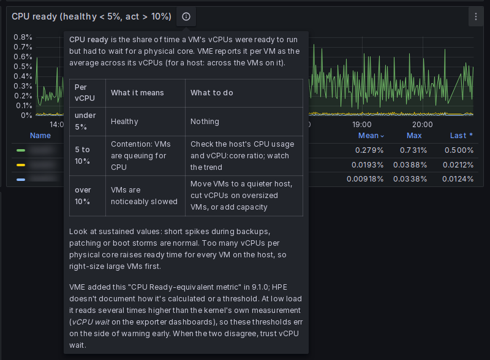 | 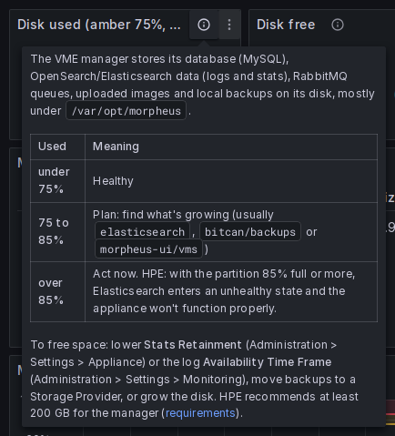 |

| Is the manager sized as HPE recommends? | Can the cluster survive losing a host? |
|---|---|
| 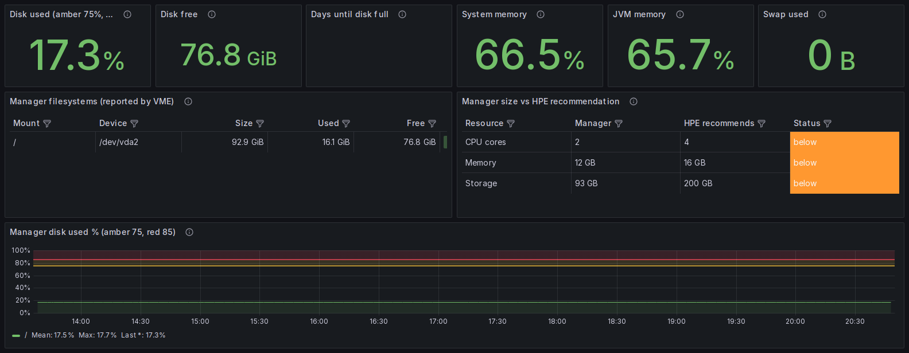 | 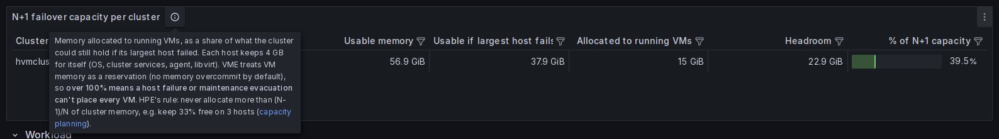 |

The vCPU-wait view on the bottleneck dashboard measures the same contention as CPU ready, from the kernel. Its tooltip explains when to trust which:

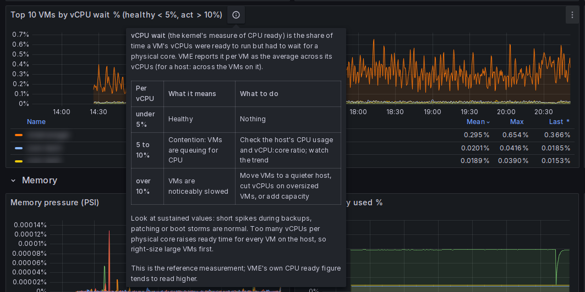

### Contention at a glance

The Overview turns CPU ready into four tiles: worst VM, worst single vCPU (which a VM's average can hide), and how many VMs are in the contention or slowdown bands.

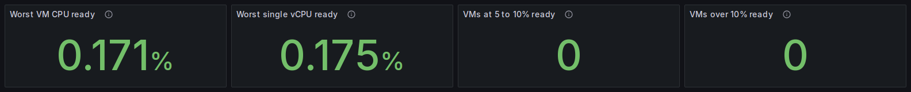

### Right-sizing

How big VMs typically are, and which ones are doing nothing. Idle means running with CPU never above 5% for a day; VME's own CPU figure reads about 2% even for an idle VM, so the threshold sits above that. The VMs dashboard lists the candidates.

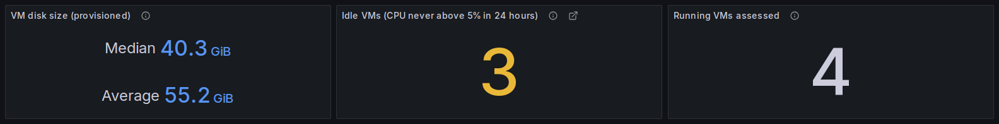

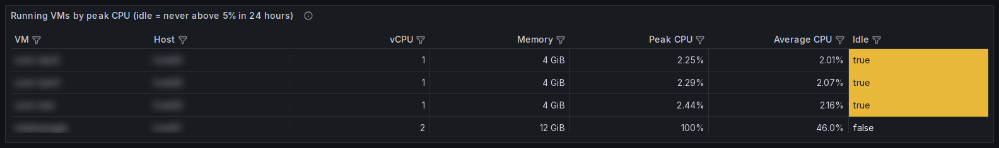

### Inventory and lifecycle

Every host and VM, with its OS release, end-of-life date, latest point release, Morpheus agent version and QEMU guest agent status, worst first. Lifecycle data comes from endoflife.date and refreshes daily.

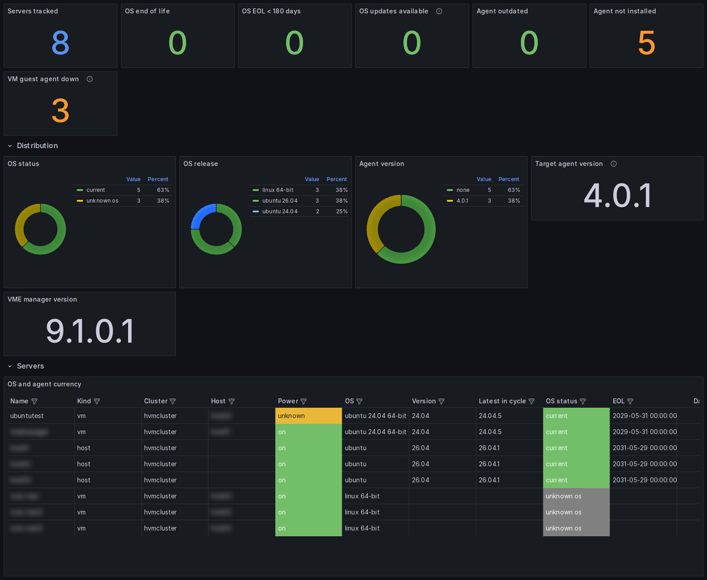

### Storage

Datastores from VME, and, with the optional exporters, every filesystem on every host. Shared datastores show their VME names instead of `/mnt/<uuid>` paths, with days-to-full and read-only detection.

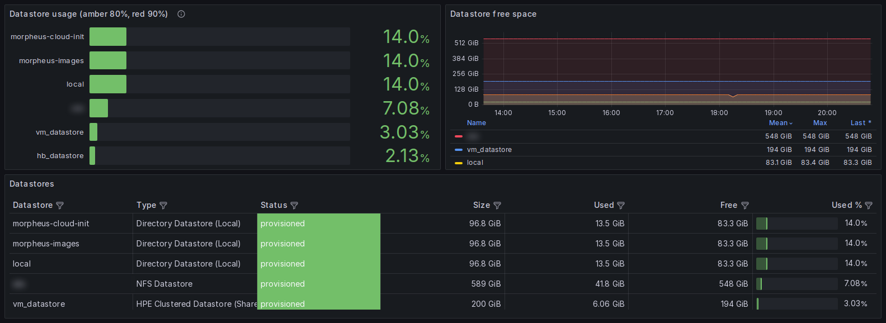

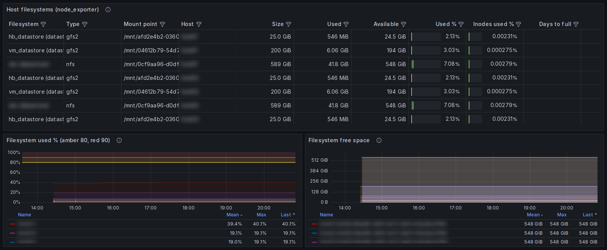

### Bottlenecks and capacity (optional exporters)

Kernel-level pressure stall information (PSI), load per core and vCPU wait show contention before users notice. Capacity shows vCPU-to-core and memory-allocated ratios per host.

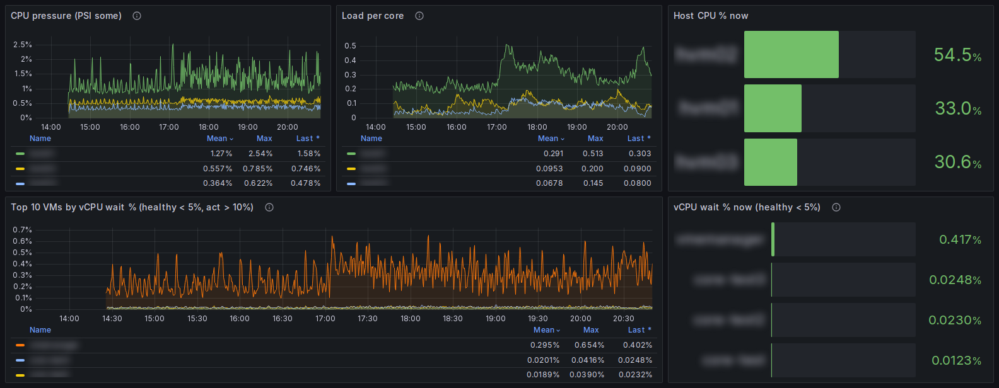

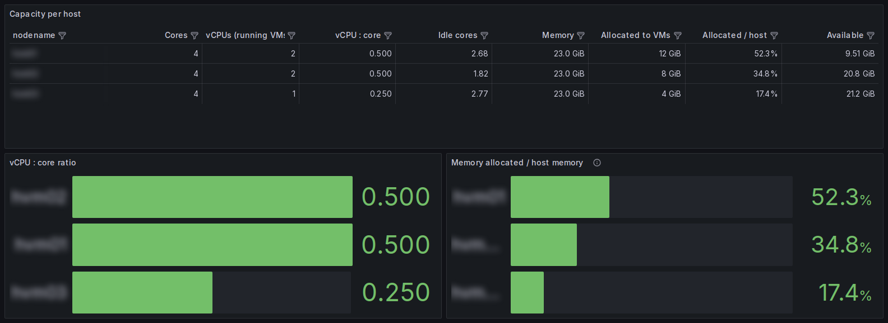

### Every dashboard

<details>
<summary>Full-page screenshots of all nine dashboards</summary>

**VME Overview**: estate, cluster capacity, N+1 headroom, hosts, datastores, manager, CPU contention, top VMs, fleet (VM disk size, idle VMs)
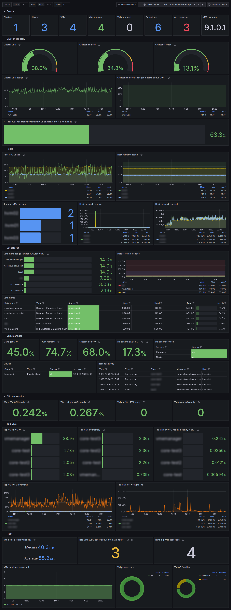

**VME Hosts**: inventory, CPU, CPU ready, memory, swap, network, local storage, filesystems, N+1, vCPU:core
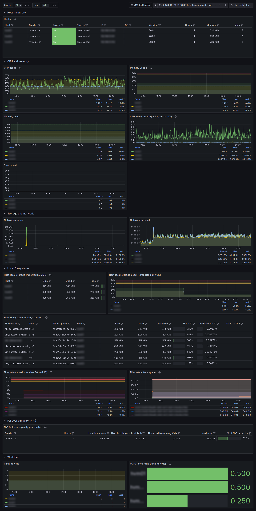

**VME Virtual Machines**: CPU, memory, disk, network, IOPS, CPU ready (average and worst vCPU), power, idle VM candidates, inventory
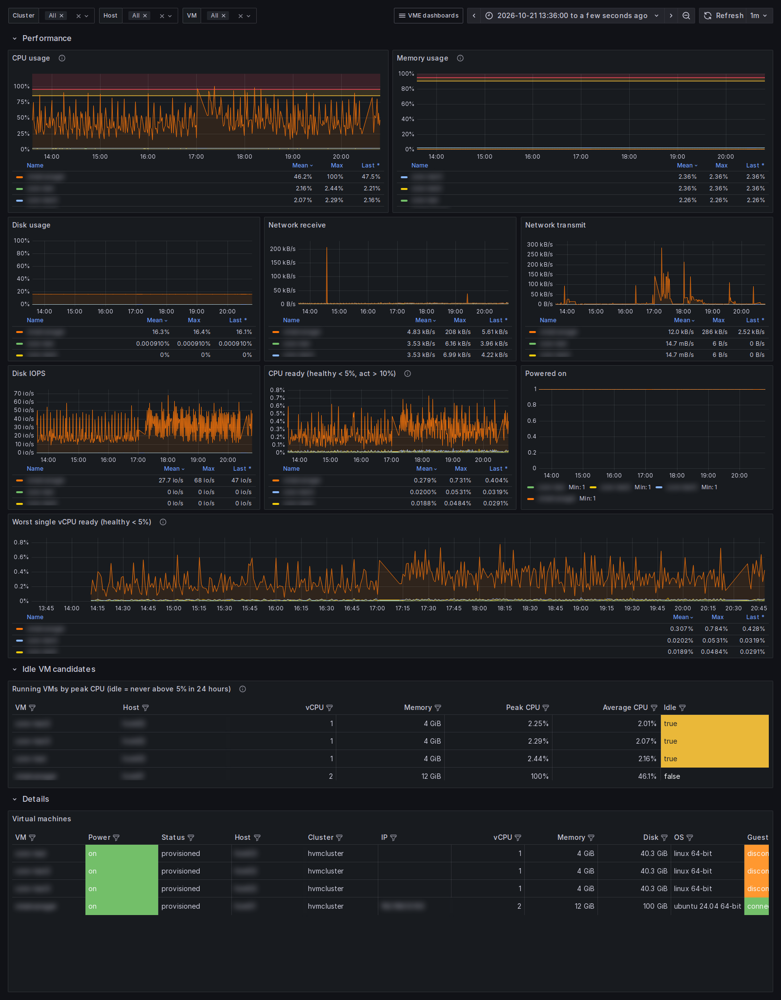

**VME Inventory & Lifecycle**: OS and agent currency, releases in use, unrecognised OS strings, change log
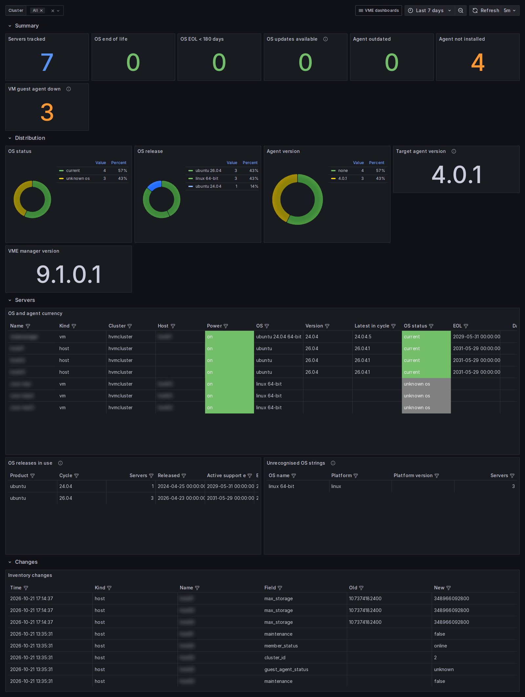

**VME Manager & Collector**: alarms, manager resources and size, services, database, RabbitMQ, Elasticsearch, manager VM detail, collector health
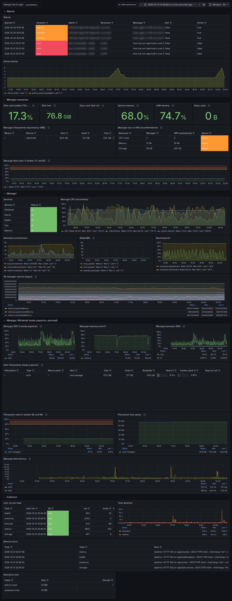

**VME HVM Hosts & VMs** *(exporters)*: host table, disk IOPS and latency, NICs, filesystems, per-VM table, top VMs
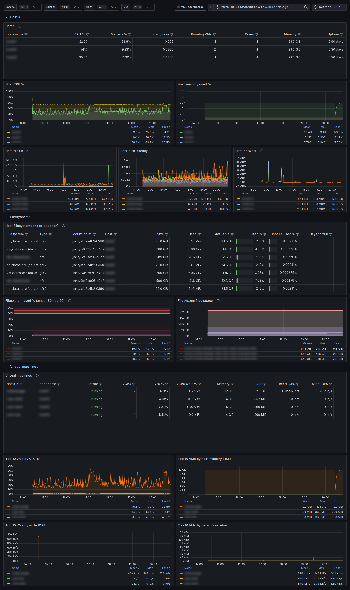

**VME HVM Bottlenecks** *(exporters)*: CPU, memory and I/O pressure, vCPU wait, swap, page faults, disk latency, noisy neighbours, drops
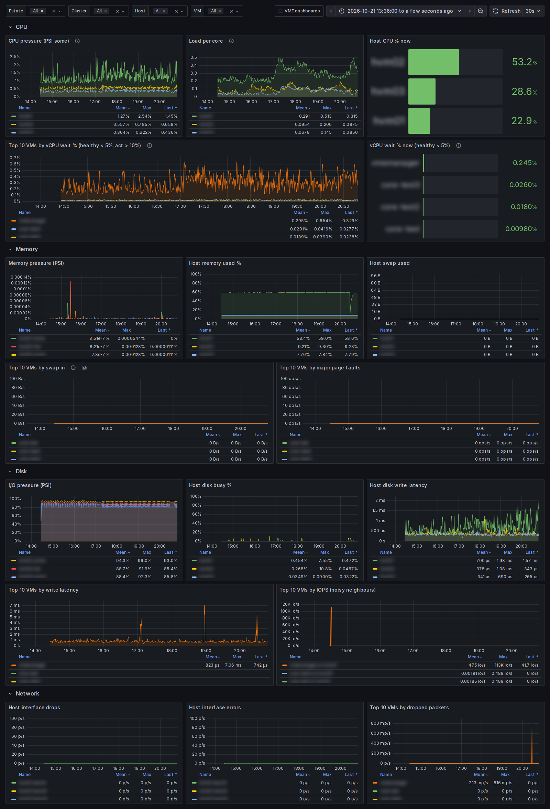

**VME HVM Capacity** *(exporters)*: allocation per host, vCPU:core, memory allocated, filesystems near full, trends
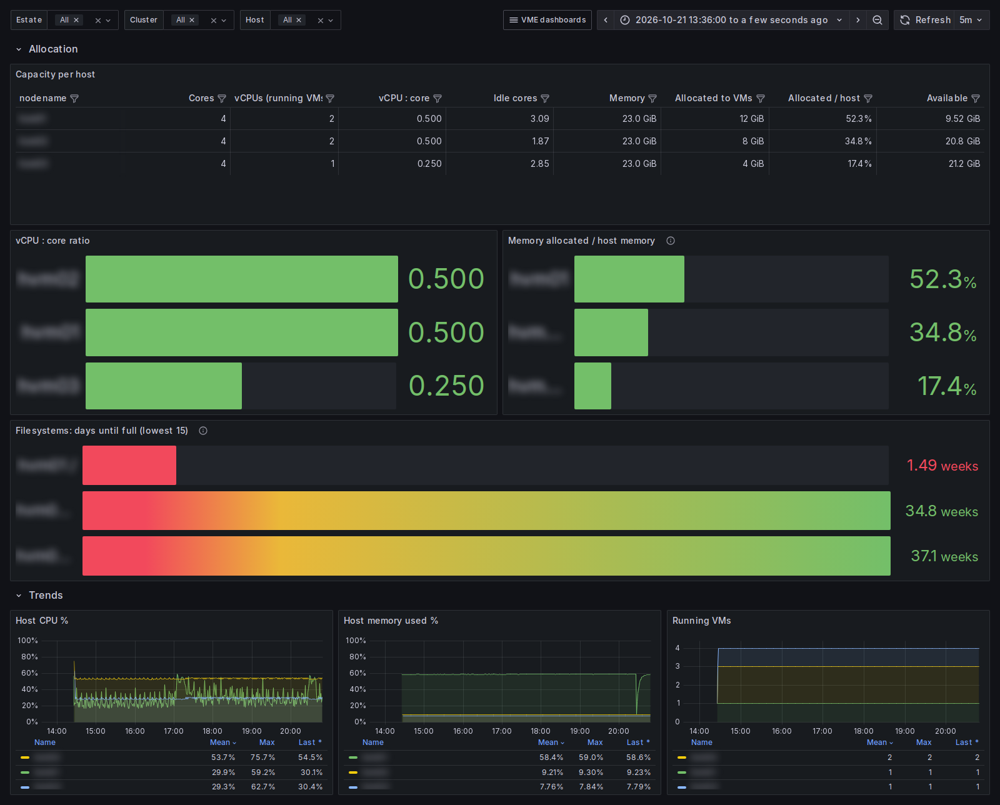

**VME Data Export**: pick kind, entities, metrics, range and resolution; download CSV from any panel
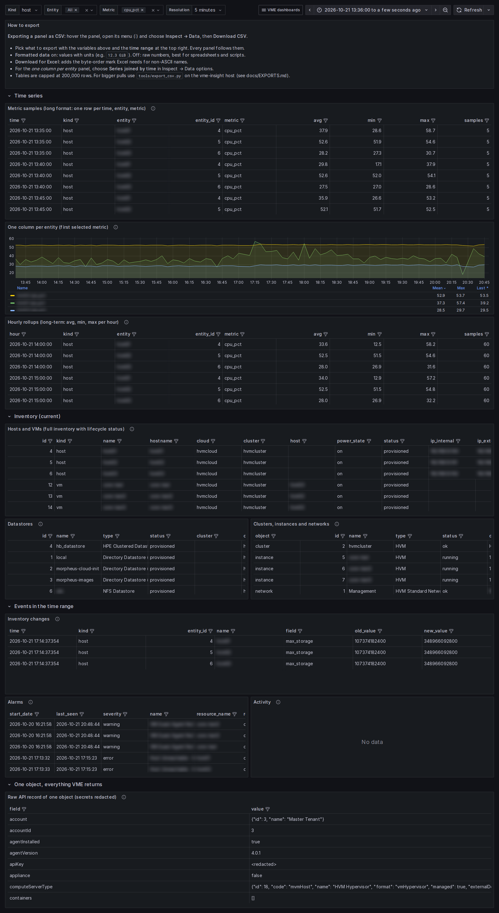

</details>

## How it works

```
                 every 60 s (metrics) / 5 min / 15 min / daily
 VME manager  ─── REST API (OAuth, TLS pinned) ───▶  collector  ──▶  TimescaleDB ──┐
 (9.1+)                                             │  (Python)      metrics +      │
                                                    │                inventory      ├─▶ Grafana
 endoflife.date ─── OS lifecycle data ──────────────┘                               │
                                                    │ writes target list            │
 HVM hosts  ── node_exporter :9100 ─┐               ▼                               │
 (optional)── libvirt exporter :9177┴──────▶  Prometheus  ──────────────────────────┘
```

* **collector**: polls `/api/servers`, `/api/clusters`, `/api/data-stores`, `/api/health`, `/api/health/alarms`, `/api/activity`, `/api/zones`, `/api/instances` and `/api/networks`. It stores time series in a TimescaleDB hypertable (compressed after 7 days, hourly rollups kept 2 years) and inventory in plain tables with a change log. It also writes Prometheus's target list from the hosts it finds, so you never maintain a host list by hand.
* **TimescaleDB**: one place to query everything with SQL. See [docs/DATA-MODEL.md](docs/DATA-MODEL.md).
* **Prometheus** (optional data): scrapes the exporters if you install them on the HVM hosts.
* **Grafana**: dashboards and data sources are provisioned from this repo.

## Quick start

```bash
git clone <this repo> vme-insight && cd vme-insight
cp .env.example .env                                # set the passwords
cp config/config.example.yaml config/config.yaml    # set url, username, password
chmod 600 .env config/config.yaml
docker compose build
docker compose run --rm collector python -m vmeinsight.tlsinfo   # copy the fingerprint into config.yaml
docker compose up -d
```

Open `http://<docker-host>:3000` (or `GRAFANA_PORT`) and sign in with `GRAFANA_ADMIN_USER` / `GRAFANA_ADMIN_PASSWORD`. Dashboards are in the **VM Essentials** folder. Data appears within a minute.

Full walkthrough, including a read-only VME account: **[docs/INSTALL.md](docs/INSTALL.md)**.

## Documentation

| | |
|---|---|
| [INSTALL](docs/INSTALL.md) | Step by step install, reader account, verification, upgrades, backup |
| [CONFIGURATION](docs/CONFIGURATION.md) | Every setting in `config.yaml` and `.env`, TLS options |
| [DASHBOARDS](docs/DASHBOARDS.md) | Every panel, what it means, and how it maps to the vSphere dashboard |
| [EXPORTERS](docs/EXPORTERS.md) | Optional node and libvirt exporters on HVM hosts |
| [LIFECYCLE](docs/LIFECYCLE.md) | How OS end of life, update and agent status are worked out |
| [EXPORTS](docs/EXPORTS.md) | CSV exports from Grafana and from the command line |
| [DATA-MODEL](docs/DATA-MODEL.md) | Tables, metric catalogue, example SQL, building your own panels |
| [TROUBLESHOOTING](docs/TROUBLESHOOTING.md) | Symptoms and fixes |
| [SECURITY](docs/SECURITY.md) | Credentials, TLS, network exposure |
| [VME-PLUGIN](docs/VME-PLUGIN.md) | *Optional:* show the dashboards inside the VME UI with vme-insight-plugin: https front end, anonymous viewing, certificates, plugin install |

## Requirements

* Docker Engine 24+ with Compose v2, on any Linux host that can reach the VME manager on 443.
* About 250 MB of RAM. Disk: roughly 6 GB per 100 hosts + VMs at the default 90-day retention; see [DATA-MODEL](docs/DATA-MODEL.md#sizing).
* A VME account with read access (see INSTALL).
* Outbound HTTPS to `endoflife.date` for lifecycle data (optional).

## Compatibility

| vme-insight | VME | vme-insight-plugin (optional) |
|---|---|---|
| 0.3.0 | 9.1 or later | 0.1.0 or later |
| 0.2.0 | 9.1 or later | 0.1.0 or later |
| 0.1.0 | 9.1 or later | Not supported (no https front end or anonymous viewing) |

## VME reference documentation

HPE's documentation for Morpheus and VM Essentials is published at [HewlettPackard/morpheus-docs](https://github.com/HewlettPackard/morpheus-docs). vme-insight's thresholds and guidance follow these pages:

| Topic | HPE page |
|---|---|
| Default alarm thresholds (CPU, memory, datastores) | [HVM alarms](https://github.com/HewlettPackard/morpheus-docs/blob/dev-9.1/infrastructure/clusters/hvm/alarms.rst) |
| Healthy ranges for HVM hosts, clusters and storage | [HVM monitoring](https://github.com/HewlettPackard/morpheus-docs/blob/dev-9.1/infrastructure/clusters/hvm/monitoring.rst) |
| N+1 failover, memory reservation, CPU overcommit ratios | [HVM capacity planning](https://github.com/HewlettPackard/morpheus-docs/blob/dev-9.1/infrastructure/clusters/hvm/capacity_planning.rst) |
| Manager sizing, disk space, Elasticsearch at 85% | [Requirements](https://github.com/HewlettPackard/morpheus-docs/blob/dev-9.1/getting_started/requirements/requirements.rst) |
| Stats and log retention settings | [Appliance settings](https://github.com/HewlettPackard/morpheus-docs/blob/dev-9.1/administration/settings/appliance.rst), [Logs](https://github.com/HewlettPackard/morpheus-docs/blob/dev-9.1/administration/settings/logs.rst) |
| Reader role permissions | [Role permissions](https://github.com/HewlettPackard/morpheus-docs/blob/dev-9.1/administration/roles/role_permissions.rst) |
| API tokens and OAuth clients | [User settings → API access](https://github.com/HewlettPackard/morpheus-docs/blob/dev-9.1/administration/user_settings/user_settings.rst), [OAuth clients](https://github.com/HewlettPackard/morpheus-docs/blob/dev-9.1/administration/settings/clients.rst) |
| Replacing the self-signed certificate | [SSL certificates](https://github.com/HewlettPackard/morpheus-docs/blob/dev-9.1/getting_started/additional/morpheusSslCerts.rst) |
| HVM host firewall | [Preparing HVM hosts](https://github.com/HewlettPackard/morpheus-docs/blob/dev-9.1/getting_started/installation/hvm_host_prep.rst) |
| QEMU guest agent, CPU ready metric (9.1.0) | [Guest OS notes](https://github.com/HewlettPackard/morpheus-docs/blob/dev-9.1/infrastructure/clusters/hvm/guest_os_notes.rst), [9.1.0 release notes](https://github.com/HewlettPackard/morpheus-docs/blob/dev-9.1/release_notes/9_1_0.rst) |

Links point at the `dev-9.1` branch, matching the supported release. Where these pages and vme-insight disagree, HPE's documentation describes VME's behaviour.

## Disclaimer

vme-insight is an independent, community-maintained open-source project.

* It is **not affiliated with, endorsed, sponsored or supported by** Hewlett Packard Enterprise (HPE), Morpheus Data, or any of their subsidiaries or affiliates, nor by Grafana Labs, Timescale, the Prometheus or endoflife.date projects, or any other organisation whose products it works with.
* HPE, Morpheus, VM Essentials, HVM and other product names are trademarks of their respective owners. They are used here only to describe what the software works with.
* It is **not an HPE product and not covered by HPE support**. Please don't raise HPE support cases about vme-insight; use this repository's issues instead.
* It reads from VME and, if you install the optional exporters, adds two small read-only services to your hosts. Check your HPE support terms before installing anything on hypervisors or the VME manager.
* It is provided "as is", without warranty of any kind. See [LICENSE](LICENSE).

## Credits

The exporter layer, bottleneck/capacity dashboards and reader-role approach were inspired by Emre Baykal's article [Monitoring HPE Morpheus HVM and HKS clusters and the appliance from your existing Grafana](https://dev.to/emre_baykal_a4a7a479d48c5/monitoring-hpe-morpheus-hvm-and-hks-clusters-and-the-appliance-from-your-existing-grafana-2hpc). The queries and dashboards here are independent implementations. OS lifecycle data comes from [endoflife.date](https://endoflife.date).

## License

MIT. See [LICENSE](LICENSE).
