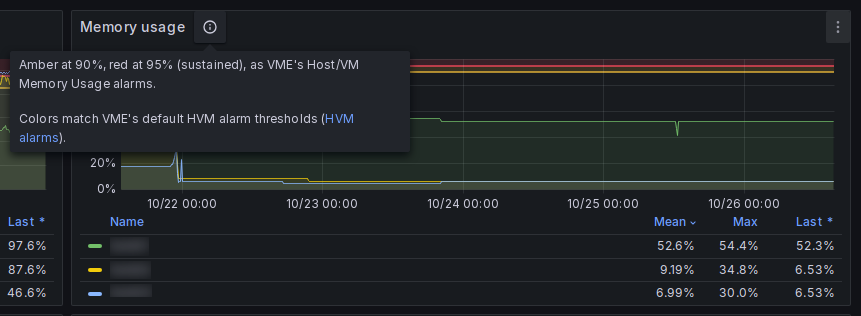
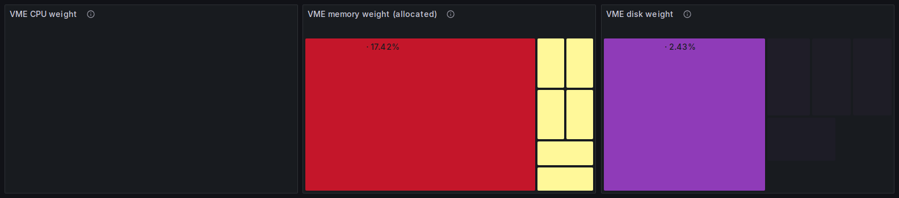
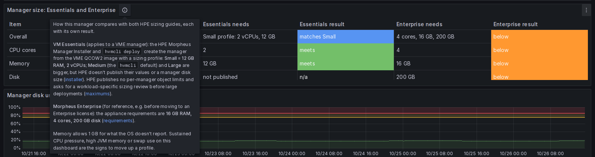
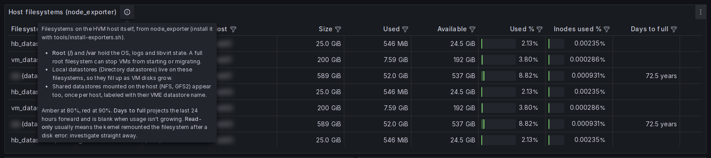

# Dashboards

All dashboards are in the **VM Essentials** folder and linked to each other from the **VME dashboards** menu at the top right. Time range and refresh carry over between them.

Dashboards are generated by [`tools/build_dashboards.py`](../tools/build_dashboards.py). To change one permanently, edit the script and run it (see [DATA-MODEL](DATA-MODEL.md#adding-or-changing-panels)). You can also edit in the Grafana UI and **Save as** a copy.

**Variables.** Most dashboards have **Cluster**, **Host** and **VM** pickers. Each one narrows the next. "All" includes servers that aren't in any cluster.

**Thresholds.** Colors follow HPE's own numbers, so red on a dashboard means VME raises an alarm too:

| Metric | Amber | Red | Source |
|---|---|---|---|
| Host and VM CPU | 85% | 95% | VME's default *CPU Usage* alarms ([HVM alarms](https://github.com/HewlettPackard/morpheus-docs/blob/dev-9.1/infrastructure/clusters/hvm/alarms.rst)) |
| Host and VM memory | 90% | 95% | VME's default *Memory Usage* alarms |
| Datastore used | 80% | 90% | VME's default *Datastore Usage* alarms. HPE's monitoring guide: under 15% free risks provisioning failures ([HVM monitoring](https://github.com/HewlettPackard/morpheus-docs/blob/dev-9.1/infrastructure/clusters/hvm/monitoring.rst)). |
| Cluster memory | 70% | 85% | Capacity planning: above 70% cluster-wide puts N+1 failover at risk ([capacity planning](https://github.com/HewlettPackard/morpheus-docs/blob/dev-9.1/infrastructure/clusters/hvm/capacity_planning.rst)) |
| N+1 failover headroom | 90% | 100% | Over 100%: a host failure can't place every VM |
| Agent check-in age | 2 min | 5 min | Healthy within 2 minutes; VME raises *Host Unreachable* after 5 |
| Manager disk | 75% | 85% | At 85% Elasticsearch becomes unhealthy and the appliance won't function properly ([requirements](https://github.com/HewlettPackard/morpheus-docs/blob/dev-9.1/getting_started/requirements/requirements.rst)) |
| CPU ready / vCPU wait | 5% | 10% | Industry rule of thumb; HPE publishes none (see below) |
| Host filesystems | 80% | 90% | Same as datastores |

VME evaluates its CPU and memory alarms on a 15-minute average, so short peaks on these graphs that cross a line are normal. VME's alarm thresholds can be changed; if you change them, change `CPU_STEPS`, `MEM_STEPS` and `DS_STEPS` in `tools/build_dashboards.py` to match.

**Units.** VME reports network usage as `netRxUsage` / `netTxUsage`. These are shown as bytes per second. Treat them as relative values until you have compared them with exporter data on your own estate.

## VME Overview

The home page. It plays the same role as the vSphere Overview dashboard.

| Row | Panels |
|---|---|
| Estate | Clusters, hosts, VMs, running and stopped VMs, datastores, active alarms, manager version |
| Cluster capacity | CPU, memory and host-storage gauges per cluster. CPU and memory over time. **N+1 failover headroom**: memory allocated to running VMs as a share of what the cluster could hold if its largest host failed. |
| Hosts | CPU % and memory % per host, running VMs per host, host network |
| CPU contention | Worst VM CPU ready, worst single vCPU ready, VMs at 5 to 10% ready, VMs over 10% ready. Tiles turn amber and red at the thresholds below. |
| Datastores | Used % per datastore, free space over time, and a table with type, status, size and used % |
| VME manager | Manager CPU, JVM memory, system memory, storage, service status (database, Elasticsearch, RabbitMQ), clouds with last sync time, recent activity |
| VM resource weight | Three treemaps: each VM is a rectangle sized and colored by its share of the cluster's **CPU** (usage × vCPUs over all host cores), **allocated memory** (VME reserves a VM's whole allocation, so that's what it takes from the cluster) and **storage** (disk in use over the capacity of the datastores the VM's disks are on; includes stopped VMs). Labels show the share. Very small VMs can be too thin to see; hover for values. Needs the Treemap panel plugin, which Grafana installs on first start. |
| Top VMs | Top N (picker) by CPU, memory and CPU ready. CPU and network of the busiest VMs over time. |
| Fleet | **VM disk size**: median and average provisioned disk per VM (a median well below the average means a few very large VMs). **Idle VMs**: running VMs whose CPU never went above 5% in 24 hours, out of the running VMs assessed. Running vs stopped VMs over time, power state, OS families. |

### CPU ready guidance

CPU ready is the share of time a VM's vCPUs were ready to run but had to wait for a physical core. It's the first sign that a host has more VM CPU demand than it can schedule. VME reports it per VM as the **average across the VM's vCPUs, in percent**. For a host, the figure covers the VMs on it. The rule of thumb, carried over from vSphere practice:

| Per vCPU | Meaning | What to do |
|---|---|---|
| under 5% | Healthy | Nothing |
| 5 to 10% | Contention: VMs are queuing for CPU | Check the host's CPU usage and vCPU:core ratio; watch the trend |
| over 10% | VMs are noticeably slowed | Move VMs to a quieter host, cut vCPUs on oversized VMs, or add capacity |

Judge sustained values, not short spikes during backups, patching or boot storms. Every CPU-ready panel shows these thresholds in its title and as shaded bands, and its info tooltip (ⓘ) has the full table. **Worst single vCPU** catches a VM with one starved vCPU, which its average hides. VME added this as a "CPU Ready-equivalent metric for monitoring vCPU scheduling contention" in 9.1.0 ([release notes](https://github.com/HewlettPackard/morpheus-docs/blob/dev-9.1/release_notes/9_1_0.rst)), but HPE doesn't document how it's calculated or what threshold to use. We checked it on a VME 9.1 lab against the kernel's own measurement (libvirt's vCPU delay, shown as **vCPU wait** on the exporter dashboards), over the same 5 minutes:

| VM | VME CPU ready | Kernel vCPU wait (per vCPU) |
|---|---|---|
| vmemanager (2 vCPU) | 0.238% | 0.043% |
| core-test2 (1 vCPU) | 0.016% | 0.002% |
| core-test3 (1 vCPU) | 0.019% | 0.003% |

VME's per-vCPU values average exactly to its VM value, so it is a per-vCPU average. At this (very low) load it read 5 to 8 times higher than the kernel figure, which means the thresholds above warn early rather than late on VME's figure. **When the two disagree, trust vCPU wait.** Comparisons under real contention are welcome as issues.

**Cluster CPU** is the average CPU of the cluster's hosts. **Cluster memory** is total used over total installed. **Cluster storage** is the sum of the hosts' local storage. Shared datastores are shown separately because they don't belong to one host.

## VME Hosts

| Panel | Meaning |
|---|---|
| Hosts table | Cluster, power, status, IP, OS and version, cores, memory, VMs and running VMs, Morpheus agent version and last check-in, cluster membership, maintenance mode, CPU model, hardware |
| CPU usage / Memory usage / Memory used | As reported by the VME agent on the host |
| CPU ready | Time VM vCPUs on the host were ready to run but waited for a physical CPU, with bands at 5% and 10%. See [CPU ready guidance](#cpu-ready-guidance). |
| Swap used | Host swap. Any steady use on a hypervisor is a warning sign. |
| Network receive/transmit | Per host |
| Agent age (in the Hosts table) | Time since the host's Morpheus agent reported: amber after 2 minutes, red after 5 (VME's *Host Unreachable*). |
| Host local storage (reported by VME) | Size, used, free and used % of each host's local disks. VME reports one total per host. |
| Host filesystems (node_exporter) | One row per filesystem on each host. VME datastores are shown by name, for example `silo (datastore)` instead of `/mnt/0cf9aa96-…`, using the datastore paths VME reports. Columns: size, used, available, used %, inodes used %, days to full, read-only flag. Needs the [exporters](EXPORTERS.md). Root and `/var` matter most, because a full root filesystem can stop VMs from starting. NFS and GFS2 datastores mounted on the host also appear. |
| Filesystem used %, free space | Per mount over time, amber at 80% and red at 90% |
| Running VMs | Over time |
| N+1 failover capacity per cluster | Hosts, usable memory (installed minus the 4 GB each host keeps for itself), usable memory if the largest host fails, memory allocated to running VMs, headroom, and % of N+1 capacity. VME treats VM memory as a reservation (no overcommit by default), so above 100% a host failure or maintenance evacuation can't place every VM. HPE's rule is to keep (N-1)/N of memory as the ceiling, e.g. 33% free on 3 hosts ([capacity planning](https://github.com/HewlettPackard/morpheus-docs/blob/dev-9.1/infrastructure/clusters/hvm/capacity_planning.rst)). |
| vCPU : core ratio | vCPUs of running VMs divided by the host's cores. Green below 4, amber to 8, red above. HPE's guidance: 1:1 latency-sensitive, 2:1 general purpose, 4:1 dev/test, 8:1+ only for idle or bursty workloads ([capacity planning](https://github.com/HewlettPackard/morpheus-docs/blob/dev-9.1/infrastructure/clusters/hvm/capacity_planning.rst)). |

## VME Virtual Machines

CPU, memory and disk usage (%), network, disk IOPS, CPU ready (average and worst single vCPU, with guidance bands) and power history per VM, a list of **idle VM candidates** (running VMs ordered by peak CPU over 24 hours, idle when never above 5%), and a VM table: power, status, host, cluster, IP, vCPU, memory, disk, OS, QEMU guest agent, Morpheus agent, cloud, plan, image, owner and creation date.

Why 5%: VME reports about 2% CPU even for a VM the kernel measures at under 1% (seen on a 9.1 lab), so a lower threshold would never match. To redefine idle, change `IDLE_PCT` and `IDLE_WINDOW` in `tools/build_dashboards.py` and rebuild.

VM memory % comes from inside the guest and needs the **QEMU guest agent**. Without it VME reports host-side figures, or nothing.

## VME Inventory & Lifecycle

| Panel | Meaning |
|---|---|
| Summary counters | Servers tracked, OS end of life, OS EOL within 180 days, OS updates available, Morpheus agent outdated or missing, VMs with the guest agent down |
| OS status / OS release / Agent version | Distribution charts |
| Target agent version | The Morpheus agent version treated as current |
| OS and agent currency | One row per host and VM, worst first. See [LIFECYCLE](LIFECYCLE.md) for what each status means. |
| OS releases in use | Each OS release in the estate with its support and end-of-life dates and latest point release |
| Unrecognized OS strings | OS names that didn't match a lifecycle product. Add `os_rules` for them. |
| Inventory changes | Every change to a host or VM in the time range: discovered, removed, power, status, OS, agent, guest agent, size, host (migration), cluster, maintenance |

This dashboard defaults to the last 30 days.

## VME Manager & Collector

### Manager disk guidance

The manager stores its database (MySQL), OpenSearch/Elasticsearch data (logs and stats), RabbitMQ queues, uploaded images and local backups on its disk, mostly under `/var/opt/morpheus`. Disk panels are amber at 75% and red at 85%:

| Used | Meaning |
|---|---|
| under 75% | Healthy |
| 75 to 85% | Plan: find what's growing, usually `/var/opt/morpheus/elasticsearch`, `/var/opt/morpheus/bitcan/backups` or `/var/opt/morpheus/morpheus-ui/vms` |
| over 85% | Act now. HPE: "With partition space at 85% filled or higher (by default), Elasticsearch will enter an unhealthy state and the appliance will not function properly." ([requirements](https://github.com/HewlettPackard/morpheus-docs/blob/dev-9.1/getting_started/requirements/requirements.rst)) |

To free space:

* Lower **Stats Retainment** (30, 60 or 90 days) in **Administration → Settings → Appliance** ([Appliance settings](https://github.com/HewlettPackard/morpheus-docs/blob/dev-9.1/administration/settings/appliance.rst)).
* Shorten the log retention, set by **Availability Time Frame** in **Administration → Settings → Monitoring** ([Logs](https://github.com/HewlettPackard/morpheus-docs/blob/dev-9.1/administration/settings/logs.rst)).
* Send backups to a Storage Provider instead of the manager's disk.
* Grow the disk. HPE doesn't publish a disk size for the VM Essentials manager; it comes with the QCOW2 image the manager is deployed from.

### Manager size

The **Manager size: Essentials and Enterprise** table compares the manager with both HPE sizing guides and gives a result for each.

**VM Essentials** applies to a VME manager. The HPE Morpheus Manager Installer and `hvmcli deploy` create the manager from the VME QCOW2 image with one of three sizing profiles ([installer](https://github.com/HewlettPackard/morpheus-docs/blob/dev-9.1/getting_started/installation/singleNode/hpe_installer.rst), [hvmcli deploy](https://github.com/HewlettPackard/morpheus-docs/blob/dev-9.1/tools/hvmcli/deploy.rst)):

| Profile | vCPUs | Memory | Notes |
|---|---|---|---|
| Small | 2 | 12 GB | |
| Medium | not published | not published | `hvmcli` default |
| Large | not published | not published | |

HPE says to choose the profile by expected managed hosts, VMs, total objects, enabled integrations and workload. It publishes no per-manager object limits and asks for a workload-specific sizing review before large deployments ([VME maximums](https://github.com/HewlettPackard/morpheus-docs/blob/dev-9.1/infrastructure/clusters/hvm/maximums.rst)). No manager disk size is published for VME. For each guide the table shows what it **needs** and the **result** for this manager. The **Essentials result** on the Overall row says *below Small*, *matches Small* or *Medium or Large*; anything above Small can't be placed more precisely.

**Morpheus Enterprise** appliance requirements are 4 cores, 16 GB memory and 200 GB disk ([requirements](https://github.com/HewlettPackard/morpheus-docs/blob/dev-9.1/getting_started/requirements/requirements.rst)). The **Enterprise result** column shows whether the manager meets them, for reference, for example before moving to an Enterprise license. A VME manager at the Small profile shows *below*, which is expected.

Memory checks allow 1 GB for memory the OS doesn't report. Matching a profile doesn't prove the manager has enough capacity: sustained CPU pressure, high JVM memory or swap use on this dashboard are the signs to move up a profile.

## VME Data Export

A dashboard laid out for CSV export: choose kind, entities, metrics, time range and resolution, then use **Inspect → Data → Download CSV** on any panel. It covers metric samples (long and wide format), hourly rollups, full inventory with lifecycle status, inventory changes, alarms, activity, and one object's raw API record. See [EXPORTS](EXPORTS.md), which also covers `tools/export_csv.py` for exports too big for a browser.

## VME Summary tiles (for embedding)

`vme-widget`: the estate and CPU contention tiles from VME Overview, one per panel, for showing single tiles in other pages (Grafana's `/d-solo/vme-widget?panelId=<id>`). The [VME plugin](VME-PLUGIN.md) uses it for its home dashboard. Cluster and host filters are hidden and default to All.

Its panel ids are fixed, unlike other dashboards' ids, which follow build order. Pages that embed a tile can rely on them across vme-insight releases; new tiles get new ids.

| ID | Tile | ID | Tile |
|---|---|---|---|
| 1 | Clusters | 7 | Active alarms |
| 2 | Hosts | 8 | VME manager (version) |
| 3 | VMs | 9 | Worst VM CPU ready |
| 4 | VMs running | 10 | Worst single vCPU ready |
| 5 | VMs stopped | 11 | VMs at 5 to 10% ready |
| 6 | Datastores | 12 | VMs over 10% ready |

## Exporter dashboards

These need the optional exporters ([EXPORTERS](EXPORTERS.md)). Their variables are **Estate** (the `source` label), **Cluster**, **Host** and **VM**.

### VME HVM Hosts & VMs

* **Hosts table**: CPU %, memory %, load per core, running VMs, cores, memory, uptime.
* Host CPU %, memory %, disk IOPS (read/write), disk latency, physical NIC traffic (virtual interfaces are excluded).
* **VM table**: state, vCPU, CPU % (of allocated vCPUs), vCPU wait %, memory, RSS, read/write IOPS, receive/transmit.
* **Filesystems**: the same per-mount table and charts as on VME Hosts.
* Top 10 VMs by CPU, RSS, write IOPS and network receive.

### VME HVM Bottlenecks

| Row | Panels | Read it as |
|---|---|---|
| CPU | CPU pressure (PSI), load per core, host CPU now, top VMs by vCPU wait | PSI "some" above ~10% sustained, or vCPU wait above ~5%, means VMs are queuing for CPU |
| Memory | Memory pressure (PSI some/full), memory used, swap used, VM swap-in, VM major faults | Any "full" memory pressure or rising swap means the host is short of memory |
| Disk | I/O pressure, disk busy %, write latency, VM write latency, top VMs by IOPS | Find the noisy neighbor behind latency spikes |
| Network | Interface drops and errors, VM dropped packets | Should be zero. Steady drops mean a saturated or faulty link. |

### VME HVM Capacity

* **Capacity per host**: cores, vCPUs of running VMs, vCPU:core, idle cores, installed memory, memory allocated to running VMs, allocated/installed, available memory.
* vCPU:core ratio and memory-allocated bar charts.
* Filesystems closest to full, at the last 24 hours' growth rate.
* 30-day trends of host CPU, host memory and running VMs.

## Mapping from the vSphere Overview dashboard

| vSphere Overview (8159) | vme-insight |
|---|---|
| ESXi hosts, VMs, datastores counters | Overview → Estate |
| Cluster CPU / memory usage | Overview → Cluster capacity |
| Host CPU / memory usage | Overview → Hosts, VME Hosts |
| Datastore usage | Overview → Datastores |
| VM CPU / memory top N | Overview → Top VMs |
| CPU ready | VME Hosts / VME VMs → CPU ready; HVM Bottlenecks → vCPU wait |
| Disk latency | HVM Hosts & VMs, HVM Bottlenecks (exporters) |
| *(host filesystems not shown)* | VME Hosts → Local filesystems, HVM Hosts & VMs → Filesystems |
| Network usage | Overview, VME Hosts, VME VMs; physical NICs in HVM Hosts & VMs |
| *(no equivalent)* | Lifecycle and agent currency, change log, manager health, PSI pressure |
