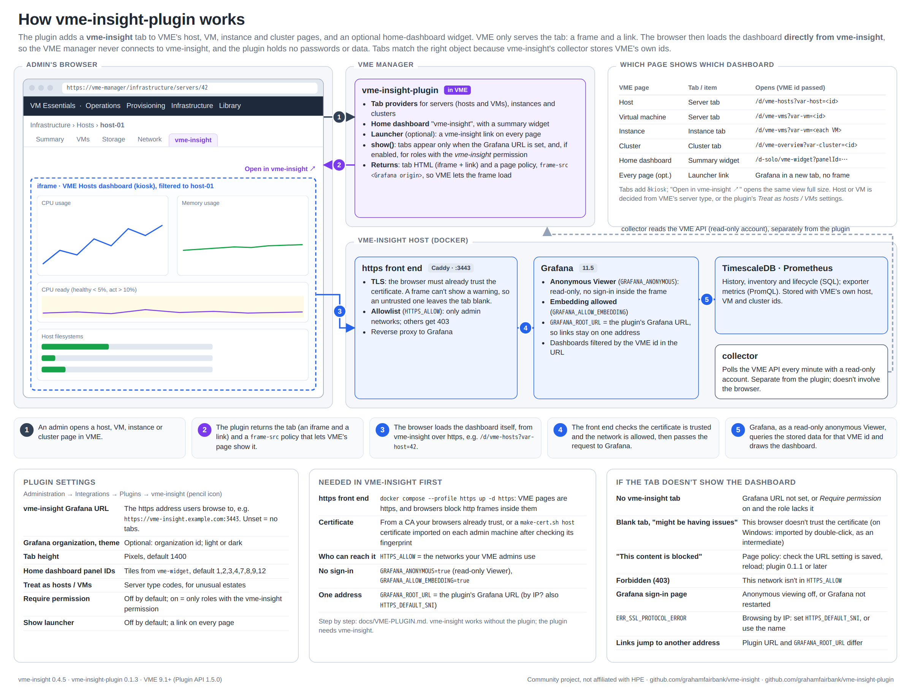

# Optional: vme-insight inside VME (VME UI plugin)

vme-insight is a complete web site on its own. If you also want its dashboards **inside the VME UI**, install the companion plugin, [vme-insight-plugin](https://github.com/grahamfairbank/vme-insight-plugin). It adds a **vme-insight** tab to every host, VM, instance and cluster page, showing the matching vme-insight dashboard. It can also add a vme-insight dashboard to VME's home page.

This page is the whole setup, end to end. The plugin's own repository has the reference detail: every setting, the authentication options compared, troubleshooting and development.

> The plugin is part of the same community project and carries the same [disclaimer](../README.md#disclaimer): it is not affiliated with, endorsed or supported by HPE or Morpheus Data. Like any plugin, it runs inside your VME manager; check your HPE support terms before installing third-party plugins on a production manager.

## How it fits together

[](architecture/vme-insight-plugin.pdf)

*Click the picture for the PDF. Source: [`architecture/plugin.html`](architecture/plugin.html), rendered with `architecture/render_plugin.py`.*

* The plugin only builds a link. The **browser** loads the dashboard straight from vme-insight's Grafana, inside the tab. VME never connects to Grafana, and the plugin stores no credentials.
* The browser must reach Grafana **over https** (VME is https, and browsers block http frames inside https pages), **without a sign-in** (a sign-in inside a frame on another site doesn't stick), and **trust its certificate** (a frame can't show a certificate warning; it just stays blank).
* So this setup turns on vme-insight's https front end and read-only anonymous access, limited to the networks your VME admins use. [SECURITY](SECURITY.md#anonymous-viewers) explains what anonymous viewers can and can't do.

## Compatibility

| vme-insight-plugin | Needs vme-insight | VME |
|---|---|---|
| 0.1.4 | 0.2.0 or later | 9.1 or later (Plugin API 1.5.0) |
| 0.1.3 | 0.2.0 or later; tested with 0.4.4 | 9.1 or later (Plugin API 1.5.0) |
| 0.1.2 | 0.2.0 or later (https front end, anonymous access, `vme-widget` dashboard) | 9.1 or later (Plugin API 1.5.0) |
| 0.1.0 – 0.1.1 | 0.2.0 or later | 9.1 or later |

vme-insight works without the plugin. The plugin does nothing without vme-insight. Install them in that order, and upgrade vme-insight first when a plugin release asks for a newer version.

## 1. Before you start

* vme-insight installed and collecting from **the same VME manager** you'll install the plugin on ([INSTALL](INSTALL.md)). The tabs pass VME's ids to the dashboards, so both must describe the same estate.
* The name your users will type for vme-insight, for example `vme-insight.example.com`, resolving to the Docker host.
* The networks your VME admins work from, for example `10.20.0.0/16`.
* A VME account that can manage plugins (**Administration → Integrations**).

## 2. Turn on https and anonymous viewing

Add to `.env`:

```bash
GRAFANA_BIND=127.0.0.1                       # Grafana's own port only on the Docker host
GRAFANA_ALLOW_EMBEDDING=true                 # allow Grafana inside VME pages
GRAFANA_ANONYMOUS=true                       # read-only Viewer without signing in
GRAFANA_ROOT_URL=https://vme-insight.example.com:3443/
GRAFANA_COOKIE_SECURE=true
HTTPS_HOSTNAME=vme-insight.example.com       # the name users type (add the IP too if they use it)
# HTTPS_DEFAULT_SNI=10.0.0.25                # only if users browse by IP: that IP (see below)
HTTPS_ALLOW="10.20.0.0/16 192.168.13.0/24"   # networks allowed in; everyone else gets 403
HTTPS_TLS="/certs/vme-insight.crt /certs/vme-insight.key"   # see step 3 to choose and create it
```

**Browsing by IP.** Prefer a name. If users do type an IP (e.g. over a VPN), add it to `HTTPS_HOSTNAME`, set `HTTPS_DEFAULT_SNI` to it, and include it in the certificate (`tools/make-cert.sh host <name> <ip>`). Without `HTTPS_DEFAULT_SNI`, `https://<ip>:3443` fails with `ERR_SSL_PROTOCOL_ERROR`. Use the same address in `GRAFANA_ROOT_URL` and in the plugin's settings that users actually browse to, or Grafana's links and redirects will point at the other one.

Decide on the certificate first ([step 3](#3-make-browsers-trust-the-certificate)). If you have no certificate yet, `tools/make-cert.sh host <name> [<ip>]` makes one for this host only in a few seconds. `HTTPS_TLS=internal` also works without any files, but it's a lab shortcut with real risks, explained in step 3.

Then:

```bash
docker compose up -d grafana
docker compose --profile https up -d https
```

vme-insight is now at `https://vme-insight.example.com:3443` for the allowed networks, and `http://<docker-host>:<GRAFANA_PORT>` only answers on the Docker host itself. Admins still sign in (top right → **Sign in**) for anything beyond viewing. Every setting is described in [CONFIGURATION](CONFIGURATION.md#env).

## 3. Make browsers trust the certificate

A frame can't show a certificate warning, so the browser on every machine that shows the vme-insight tabs must trust the front end's certificate. Otherwise the tabs stay blank.

Adding trust to a browser is a security decision: whatever you trust can vouch for sites. Pick the first option that works for you; they're ordered from least to most new trust.

| Option | What browsers must trust | If its key leaks |
|---|---|---|
| **A. Your organization's CA** issues the certificate | Nothing new | Normal certificate risk |
| **B. A public certificate** (e.g. Let's Encrypt via DNS) for a real DNS name | Nothing new | Normal certificate risk |
| **C. `tools/make-cert.sh host`**: a self-signed certificate for this host only | That one certificate | Only this host's names can be impersonated |
| **D. `tools/make-cert.sh ca`**: your own CA, limited to your domain and network | A CA restricted by name constraints | Only names inside the permitted domain and network |
| **E. Built-in CA** (`HTTPS_TLS=internal`): lab shortcut | An unrestricted CA whose key sits in a Docker volume | **Any website**, for every machine that trusts it |

### A or B: a certificate from a CA you already trust

Request a server certificate whose Subject Alternative Names include every name in `HTTPS_HOSTNAME` (and any IP users type). Save the certificate (with its intermediate chain, leaf first) and its key in `https/certs/`, which is git-ignored, then:

```bash
# .env
HTTPS_TLS="/certs/vme-insight.crt /certs/vme-insight.key"
```

```bash
docker compose --profile https up -d https
```

Nothing needs importing on the browser machines. Renew before it expires, the same way.

### C. A self-signed certificate for this host (recommended without an organization CA)

```bash
tools/make-cert.sh host vme-insight.example.com 192.0.2.10
```

Give it every name and IP your users type. The script prints each `openssl` command before running it (add `--dry-run` to see them without running anything), and writes `https/certs/vme-insight.crt` and `https/certs/vme-insight.key`. The certificate is marked `CA:FALSE`, so trusting it trusts exactly this certificate: it can't be used to sign one for any other site. It's valid for 397 days. Run the script again before then and re-import the new certificate.

Set `HTTPS_TLS` as above, restart the front end, then [verify and import](#verify-then-import) `vme-insight.crt` on each browser machine.

### D. Your own CA, limited to your domain

```bash
tools/make-cert.sh ca --permit example.com --permit 192.0.2.0/24 vme-insight.example.com 192.0.2.10
```

This creates a private CA whose **name constraints** only allow certificates for the permitted domains (and their subdomains) and networks, and uses it to sign the server certificate. Browsers import the CA once (`~/vme-insight-ca/vme-insight-ca.crt`). When the server certificate is due for renewal, run the script again and it reuses the CA, so nothing changes on the browser machines.

* **Move the CA key off the vme-insight host** (`~/vme-insight-ca/vme-insight-ca.key`) once you've issued the certificate, and bring it back only to renew. Anyone holding it can issue certificates for the permitted names.
* The constraint is enforced by the client. We've confirmed with OpenSSL that a certificate this CA signs for another domain or network is rejected (*permitted subtree violation*). Current Chrome, Edge, Firefox and Safari document the same behavior for locally trusted roots; test it in your environment if you rely on it.

Set `HTTPS_TLS` as above, restart the front end, then [verify and import](#verify-then-import) the CA certificate on each browser machine.

### E. The built-in CA (lab shortcut)

With `HTTPS_TLS=internal` (the default), the front end creates its own root CA on first start. It's convenient for a quick trial, but understand the trade-off before trusting it:

* It's an **unrestricted** CA: it can sign a certificate for any website, and every machine that trusts it would accept those.
* Its private key is stored unencrypted in the `https-data` Docker volume, readable by anyone with Docker access on the host and by anything that backs up the volume. It's valid for 10 years.
* The root is unique to your install (nothing is shipped with vme-insight), but that doesn't limit what it can sign.

Use it on a lab network, trust it for your own account only, and [remove it](#removing-trust) when you're done. For anything else use A to D. To export it:

```bash
docker compose --profile https cp https:/data/caddy/pki/authorities/local/root.crt vme-insight-root.crt
```

### Verify, then import

Don't import a certificate because a file arrived; check it's the one the server uses. On the vme-insight host, print its fingerprint (`make-cert.sh` prints it too):

```bash
openssl x509 -in https/certs/vme-insight.crt -noout -fingerprint -sha256   # option C
openssl x509 -in ~/vme-insight-ca/vme-insight-ca.crt -noout -fingerprint -sha256   # option D
openssl x509 -in vme-insight-root.crt -noout -fingerprint -sha256   # option E
```

Copy the file to the browser machine and check its fingerprint there before importing. It must match. If the [installer service](EXPORTERS.md#install) is running, it can serve the file, which is public (it holds no key):

```bash
# on the vme-insight host (option C; for D or E use that certificate file instead)
cp https/certs/vme-insight.crt installer/dist/
```

```powershell
# on a Windows browser machine
Invoke-WebRequest http://<vme-insight-host>:8097/dist/vme-insight.crt -OutFile vme-insight.crt
```

The download is plain HTTP, which is why the fingerprint check matters. Stop the installer service when you're done (`docker compose --profile installer stop installer`).

* **Windows** (PowerShell, in the folder holding the file; change the file name to match):
  ```powershell
  $f = "$PWD\vme-insight.crt"
  $c = New-Object Security.Cryptography.X509Certificates.X509Certificate2 $f
  ([Security.Cryptography.SHA256]::Create().ComputeHash($c.RawData) | ForEach-Object { $_.ToString('X2') }) -join ':'
  ```
* **macOS / Linux**: `openssl x509 -in vme-insight.crt -noout -fingerprint -sha256`

After importing, you can also open `https://<HTTPS_HOSTNAME>:<HTTPS_PORT>` directly and view the certificate from the padlock. For option C the SHA-256 fingerprint shown is the same; for D and E, the issuer is the CA you imported.

Then import it, **for your own account** unless the machine is shared:

* **Windows** (Edge, Chrome). Don't double-click the file: the wizard files it under *Intermediate Certification Authorities*, where browsers ignore it.

  **Your account only (recommended, no administrator rights).** Windows asks you to confirm installing a certificate; check the thumbprint it shows matches `$c.Thumbprint`, then click **Yes**:
  ```powershell
  Import-Certificate -FilePath $f -CertStoreLocation Cert:\CurrentUser\Root
  ```

  **Every user on a shared machine (administrator).** Approve the UAC prompt:
  ```powershell
  Start-Process powershell -Verb RunAs -ArgumentList '-NoExit','-Command',"Import-Certificate -FilePath '$f' -CertStoreLocation Cert:\LocalMachine\Root"
  ```

  Check it landed in a Root store, then close and reopen every browser window:
  ```powershell
  Get-ChildItem Cert:\CurrentUser\Root, Cert:\LocalMachine\Root | Where-Object Thumbprint -eq $c.Thumbprint | Format-List PSParentPath, Subject, NotAfter
  ```
* **macOS**: Keychain Access → **login** keychain (your account) → File → Import Items, then open the certificate → Trust → **Always Trust**. Use the System keychain only for shared Macs.
* **Firefox** keeps its own list. For options D and E: Settings → Privacy & Security → Certificates → View Certificates → **Authorities** → Import, tick *Trust this CA to identify websites*. For option C (not a CA): open `https://<HTTPS_HOSTNAME>:<HTTPS_PORT>` directly once, check the fingerprint under *Advanced → View Certificate*, then *Accept the Risk and Continue*. That trusts this one certificate for this site only.

### Switching away from the built-in CA

If your browser machines already trust the built-in CA (option E) and you move to A to D: set `HTTPS_TLS` and restart the front end, then on each browser machine import the new certificate as above **and remove the old root**, which no longer serves any purpose and can still vouch for any site. On Windows (an elevated window for the `LocalMachine` stores):

```powershell
Get-ChildItem Cert:\CurrentUser\Root, Cert:\CurrentUser\CA, Cert:\LocalMachine\Root, Cert:\LocalMachine\CA | Where-Object Subject -like '*Caddy Local Authority*' | Remove-Item
```

Until a machine imports the new certificate, its VME tabs stay blank.

### Removing trust

When you replace the certificate or stop using vme-insight, remove what you imported.

* **Windows**: in the folder holding the certificate file, run:
  ```powershell
  $c = New-Object Security.Cryptography.X509Certificates.X509Certificate2 "$PWD\vme-insight.crt"
  Get-ChildItem Cert:\CurrentUser\Root, Cert:\CurrentUser\CA | Where-Object Thumbprint -eq $c.Thumbprint | Remove-Item
  ```
  For `LocalMachine\Root` and `LocalMachine\CA`, run the same command in an elevated window. The `CA` stores catch copies filed there by a double-click install.
* **macOS**: Keychain Access → find the certificate → Delete.
* **Firefox**: View Certificates → Authorities (or Servers, for option C) → select it → Delete.

## 4. Check from your workstation

Open `https://vme-insight.example.com:3443/d/vme-overview` in a new browser tab. VME Overview should appear **without a certificate warning and without a sign-in page**.

| You see | Fix |
|---|---|
| Certificate warning (`ERR_CERT_AUTHORITY_INVALID`) | This machine doesn't trust the certificate (or its CA) yet: [step 3](#3-make-browsers-trust-the-certificate). |
| `ERR_CERT_COMMON_NAME_INVALID` | The address you typed isn't in the certificate: reissue it with every name and IP users type. |
| `ERR_SSL_PROTOCOL_ERROR` when browsing by IP | Set `HTTPS_DEFAULT_SNI` to that IP and add it to `HTTPS_HOSTNAME`: [Browsing by IP](#2-turn-on-https-and-anonymous-viewing). |
| `Forbidden` | This machine's network isn't in `HTTPS_ALLOW`. |
| Grafana's sign-in page | `GRAFANA_ANONYMOUS=true` missing, or Grafana not restarted. |
| Nothing loads | Name resolution or a firewall between you and the Docker host. |

## 5. Install the plugin

1. Download `vme-insight-plugin-<version>.jar` from the plugin's [releases](https://github.com/grahamfairbank/vme-insight-plugin/releases), or build it from source ([plugin INSTALL](https://github.com/grahamfairbank/vme-insight-plugin/blob/main/docs/INSTALL.md)).
2. In VME, go to **Administration → Integrations → Plugins** and click **Add**. Upload the jar. It appears as **vme-insight**, status **loaded** ([HPE: Plugins](https://github.com/HewlettPackard/morpheus-docs/blob/dev-9.1/administration/integrations/plugins.rst)).
3. Click the pencil icon on the **vme-insight** row. Set **vme-insight Grafana URL** to `https://vme-insight.example.com:3443`, and save. Leave the other settings at their defaults; they're described in the plugin's [CONFIGURATION](https://github.com/grahamfairbank/vme-insight-plugin/blob/main/docs/CONFIGURATION.md).

## 6. Check in VME

Reload VME, then open:

* a cluster under **Infrastructure → Clusters**: the **vme-insight** tab shows VME Overview for that cluster;
* a host under **Infrastructure → Compute → Hosts**: VME Hosts for that host. Hosts have many tabs, so look in the **▼** menu at the end of the tab row;
* a VM under **Infrastructure → Compute → Virtual Machines**, or an instance under **Provisioning → Instances**: VME Virtual Machines for it.

**Open in vme-insight ↗** at the top of each tab opens the dashboard full size. If a tab is blank, says the content is blocked, or shows "might be having issues", see the plugin's [TROUBLESHOOTING](https://github.com/grahamfairbank/vme-insight-plugin/blob/main/docs/TROUBLESHOOTING.md).

## 7. Optional extras

* **vme-insight on VME's home page.** **Administration → Settings → Appliance → Dashboards to Display**: add **vme-insight** (VME lists it as *Vme-insight*). It shows a row of tiles from vme-insight's **VME Summary tiles** dashboard (`vme-widget`): clusters, hosts, VMs, VMs running, active alarms, VME manager version, worst VM CPU ready, and VMs over 10% ready. This changes the home page for every user.
* **Only some VME roles see the tabs.** Tick **Only show to roles with the vme-insight permission** in the plugin settings, then grant **vme-insight: View dashboards → Read** to those roles under **Administration → Roles**. This hides the tabs in VME; it doesn't protect Grafana, which the network allowlist does.
* **A link on every VME page.** Tick **Show a vme-insight link on every page**.

## Removing

1. In VME, delete the plugin on **Administration → Integrations → Plugins** (trash icon). If you added it to **Dashboards to Display**, check that list.
2. In vme-insight, stop the front end with `docker compose --profile https stop https`, set `GRAFANA_ANONYMOUS=false` (and `GRAFANA_BIND=0.0.0.0` if you want the plain port back on the network), and `docker compose up -d grafana`.
3. Remove the certificate you imported on each browser machine: [Removing trust](#removing-trust). If you ever used the built-in CA, remove its *Caddy Local Authority* root too ([Switching away from the built-in CA](#switching-away-from-the-built-in-ca)).
